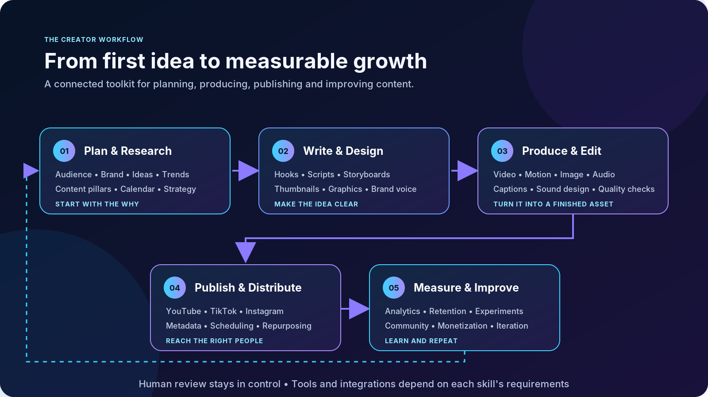
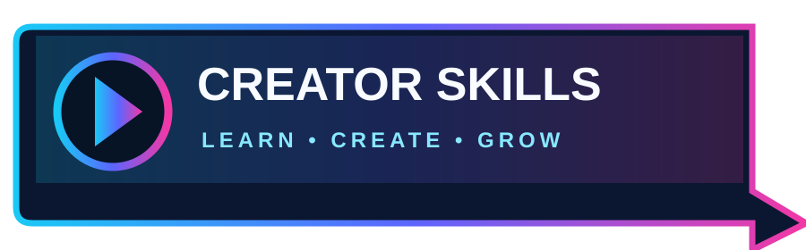

<!-- Social Media, YouTube & Creative Production Skills -->
<div align="center">
  
  <br/>
  
  <h1>Social Media, YouTube & Creative Production Skills</h1>
  <p><strong>One organized library for creator strategy, video, audio, motion design, publishing and AI-assisted workflows.</strong></p>
  <p>
    <a href="docs/SKILL_CATALOG.md">📚 Full Skill Catalog</a> ·
    <a href="docs/USAGE_GUIDE.md">🧭 Usage Guide</a> ·
    <a href="docs/CREATOR_LAUNCHPAD.md">🚀 Creator Launchpad</a> ·
    <a href="docs/BRAND_GUIDE.md">🎨 Brand Guide</a>
  </p>
  <p>
    
    
    
  </p>
</div>

---

## 🎯 What is this library?

A curated collection of **299 distinct Agent Skill instruction files** assembled from the five ZIP archives supplied in this conversation. It helps creators and compatible AI agents plan, write, design, produce, edit, publish and improve digital content.

The library has been organized without silently rewriting original `SKILL.md` files. Exact byte-for-byte duplicate copies were removed; source variants with the same skill identifier but different instructions are kept in their original package directories. See the [duplicate-removal report](docs/DEDUPE_REPORT.md) and [machine-readable manifest](manifest.json).

> **What a skill is:** a `SKILL.md` is an instruction package for a compatible agent. It does not automatically install software, grant API access, connect an account or guarantee that an external workflow can run. Read the prerequisites and supplied support files before use.

## 🗂️ Explore the five collections

| Collection | Size | Focus |
|---|---:|---|
| [Social Media & YouTube — Starter](collections/social-media-youtube-starter/README.md) | **13** | Creator strategy, channel growth, Shorts, scripts, audience research and repurposing |
| [Social Media & YouTube](collections/social-media-youtube/README.md) | **89** | Cross-platform marketing, content workflows, social automation, analytics and YouTube operations |
| [Audio, SFX, Video & Media](collections/audio-video-production/README.md) | **94** | Voice, transcription, dubbing, sound effects, music, FFmpeg, video and media libraries |
| [Motion, Design, Animation & Adobe](collections/motion-design-adobe/README.md) | **64** | After Effects, Blender, Adobe apps, Remotion, GSAP, Rive, Lottie and image tools |
| [Core & Verified Upstream Skills](docs/SKILL_CATALOG.md) | **39** | 13 project skills and 26 researched video/creative skills |

## 🎬 The creator workflow

<p align="center"></p>

## 🧭 Quick start

1. **Search the catalog.** Use [the complete index](docs/SKILL_CATALOG.md) to find a skill by name and purpose.
2. **Open the package.** Read its full `SKILL.md`, then check any `references/`, `scripts/`, `assets/`, `templates/` and `examples/` folders.
3. **Check requirements.** Skills may require Python, Node.js, FFmpeg, Blender, Adobe apps, an API key, paid plan, local runtime or MCP server.
4. **Install for your agent.** Follow the current installation method for the specific agent runtime; installation paths and formats vary.
5. **Test safely.** Use copies or sample media before batch operations, connected accounts or production publishing.

Detailed instructions: [Usage Guide](docs/USAGE_GUIDE.md) · [Safety & Alerts](docs/SAFETY_AND_ALERTS.md).

## 🧩 Repository map

```text
.
├── assets/                       # Logo, icon, banner, flag, GIF, thumbnail and diagrams
├── skills/                       # 13 project skills + 26 verified upstream skills
├── collections/
│   ├── social-media-youtube-starter/  # 13 packages
│   ├── social-media-youtube/          # 89 packages
│   ├── audio-video-production/        # 94 packages
│   └── motion-design-adobe/           # 64 packages
├── docs/                         # Catalog, guides, playbook, brand and safety docs
├── manifest.json                 # Complete skill inventory
├── INDEX-26.md                   # Verified upstream source index
├── THIRD_PARTY_NOTICES.md        # Source notices and provenance
├── CONTRIBUTING.md
└── SECURITY.md
```

## ⚠️ Production notes

- Keep API keys, tokens, passwords, cookies and private media outside the repository.
- Review permissions before using social automation, uploads, messaging or account-management tools.
- Require explicit human approval before posting, scheduling, sending, deleting or changing an external account.
- Preserve source media and use non-destructive edits where possible.
- Verify music, sound effects, fonts, stock footage, photographs, likenesses and model terms before use.
- Check final exports for duration, aspect ratio, resolution, frame rate, codec, bitrate, loudness, captions and platform requirements.
- Do not invent analytics, source citations, testimonials, guarantees or growth claims.

## 🎁 The extra: Creator Launchpad

The [Creator Launchpad](docs/CREATOR_LAUNCHPAD.md) includes a 45-minute idea-to-brief sprint, a five-stage production board, 15 reusable prompt starters and a pre-publish checklist to help put the library to work immediately. Try the [editable YouTube thumbnail template](assets/youtube-thumbnail-template.svg), or use the PNG version in the assets folder.

## 🤝 Contributing

Contributions are welcome. Keep each skill focused, document requirements, preserve original source attribution and include tests or examples when practical. See [CONTRIBUTING.md](CONTRIBUTING.md).

## 📜 Licensing and attribution

This is a mixed-source library. Different packages retain their own declarations and dependencies; do not assume a single license applies to every file. See [Licensing & Provenance](docs/LICENSING.md) and [Third-Party Notices](THIRD_PARTY_NOTICES.md).

<div align="center">
  
  <p><sub>Learn with clarity. Create with intention. Grow with evidence.</sub></p>
</div>
