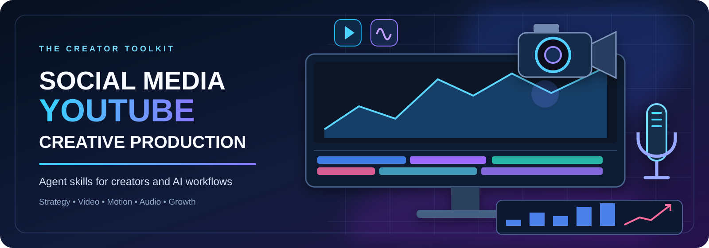
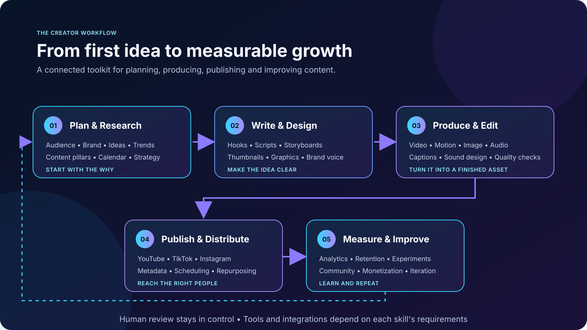

<div align="center">
  
  <h1>Social Media, YouTube & Creative Production Skills</h1>
  <p><strong>A curated library of agent skills for content strategy, video production, audio, design and creator growth.</strong></p>
  <p>
    <a href="docs/SKILL_CATALOG.md">Explore skills</a> ·
    <a href="docs/GETTING_STARTED.md">Get started</a> ·
    <a href="docs/LICENSING.md">Licensing</a> ·
    <a href="CONTRIBUTING.md">Contribute</a>
  </p>
  <p>
    
    
    
  </p>
</div>

---

## What is this repository?

This repository brings together reusable **Agent Skills** that help creators and AI agents plan, write, produce, edit, publish and improve digital content. It is designed as a structured reference library for YouTube creators, social media teams, editors, designers and agent builders.

The current repository contains 13 project-focused social media skills, 26 documented upstream video and creative skills, and 16 older upstream snapshots retained for reference. Some archived snapshots duplicate the verified set; they are kept separate so their original history remains visible.

> **What a skill is — and is not:** A `SKILL.md` file provides instructions to a compatible agent. It is not automatically an installed application, executable tool, API connection or guarantee that a workflow will run. Check each package's prerequisites and supporting files before use.

## Explore the skill library

| Area | What you can do |
|---|---|
| **YouTube growth** | Channel positioning, long-form planning, Shorts, packaging, titles, thumbnails, SEO and retention |
| **Social media strategy** | Content pillars, TikTok and Instagram workflows, audience research, brand voice and calendars |
| **Writing & creative direction** | Hooks, scripts, captions, storyboards, B-roll planning and visual direction |
| **Video production** | FFmpeg workflows, structured editing, talking-head cleanup, video analysis, rendering and quality control |
| **Motion & design** | After Effects, Blender animation, previs, Photoshop workflows and batch image editing |
| **Audio & podcasts** | Audio ducking, mixing, mastering, podcasts and audiograms |
| **Publishing & analytics** | YouTube publishing, metadata, social metrics, optimization and creator monetization |

## The creator workflow

The skills can be combined into a practical end-to-end workflow: understand the audience, develop the idea, produce a polished asset, distribute it natively, then use performance evidence to improve the next iteration.

<p align="center">
  
</p>

## Start here

1. Open the [complete skill catalog](docs/SKILL_CATALOG.md) and choose a skill by task.
2. Read its entire `SKILL.md`, including prerequisites, limitations and tool permissions.
3. Inspect any supplied `references/`, `scripts/`, `assets/` or `evals/` folders.
4. Install the skill using the method documented by your chosen agent runtime.
5. Test on non-sensitive sample material before using production assets or connected accounts.

See [Getting Started](docs/GETTING_STARTED.md) for compatibility and setup guidance.

## Repository map

```text
.
├── assets/
│   ├── hero-banner.svg
│   └── creator-workflow.svg
├── docs/
│   ├── SKILL_CATALOG.md
│   ├── GETTING_STARTED.md
│   ├── LICENSING.md
│   ├── SNAPSHOT_LIMITATIONS.md
│   └── GITHUB_ABOUT.md
├── skills/
│   ├── 01-* ... 26-*          # 26 documented upstream skills
│   ├── upstream/              # 16 historical snapshots
│   └── [13 project skills]    # Social media and YouTube skills
├── third_party/               # Preserved upstream license notices
├── INDEX-26.md
├── manifest.json
├── manifest-verified-26.json
├── THIRD_PARTY_NOTICES.md
├── CONTRIBUTING.md
└── SECURITY.md
```

## Quality, safety and responsible use

- **Human approval for external actions.** Posting, scheduling, sending, deleting or changing connected accounts must require explicit approval.
- **Evidence over hype.** Do not invent analytics, research, testimonials or guaranteed growth claims.
- **Respect rights and privacy.** Check licenses, music and footage rights, consent, platform terms and applicable privacy rules.
- **Verify changing details.** Platform specifications, model capabilities, API behavior and pricing can change; check official sources before production use.
- **Protect credentials.** Never commit API keys, tokens, passwords, cookies, private media or personal data.

## Licensing & attribution

This is a mixed-source repository. The root `LICENSE` applies only to the project-authored materials described in it; third-party skills and assets retain their own terms. Some source snapshots do not include a license or all of their referenced support files. See [Licensing & Provenance](docs/LICENSING.md), [Third-Party Notices](THIRD_PARTY_NOTICES.md) and [Snapshot Limitations](docs/SNAPSHOT_LIMITATIONS.md).

## Contributing

Contributions are welcome. Add focused skills with clear prerequisites, accurate license information, source attribution and examples or tests where possible. Read [CONTRIBUTING.md](CONTRIBUTING.md) before opening a pull request.

<div align="center">
  <sub>Learn with clarity. Create with intention. Grow with evidence.</sub>
</div>
